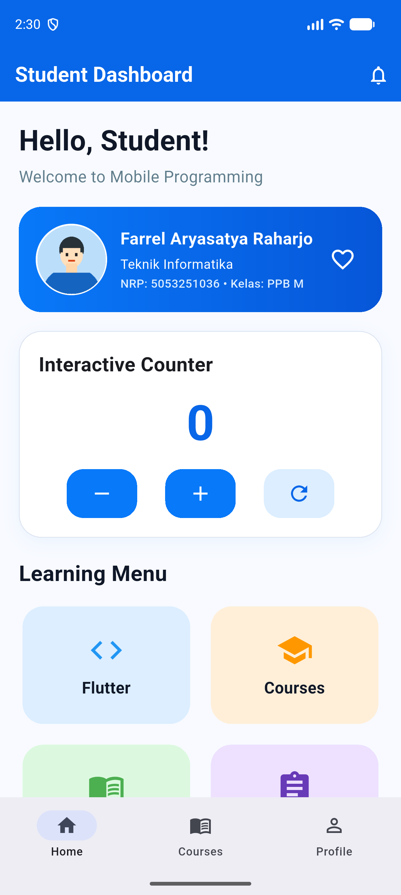
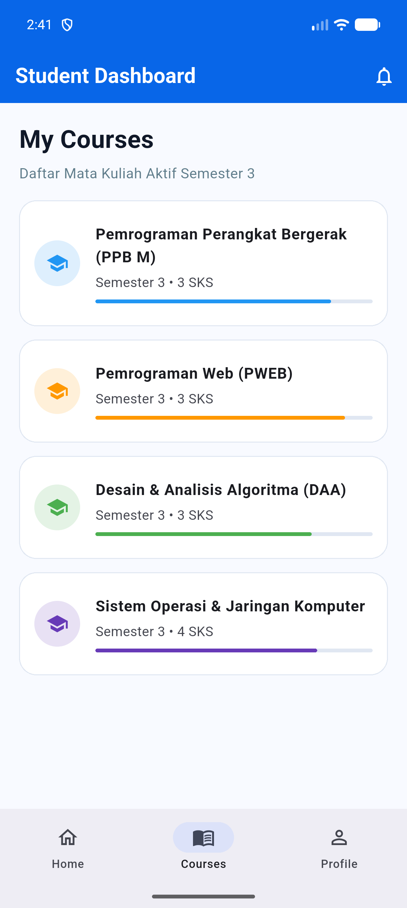
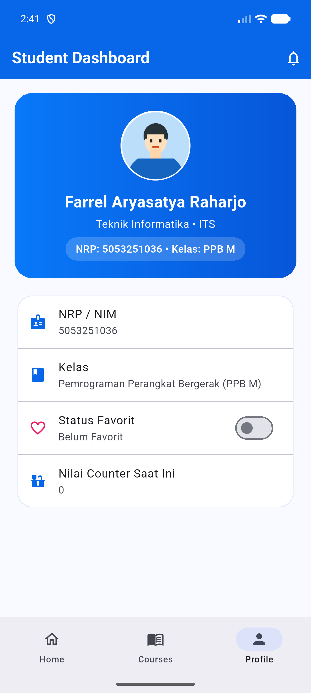
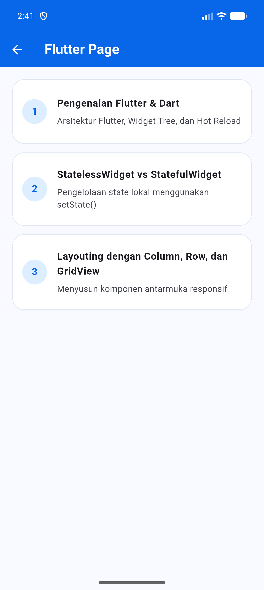

# Student Dashboard — Hands-On Lab (HOL) Flutter & Dart

- **Nama:** Farrel Aryasatya Raharjo
- **NRP:** 5053251036
- **Kelas:** PPB M
- **Tahun:** 2026

## Fitur & Tugas Pengembangan yang Diimplementasikan
1. **Student Profile Card:** Menampilkan nama mahasiswa (**Farrel Aryasatya Raharjo**), program studi (**Teknik Informatika**), **NRP (5053251036)**, **Kelas (PPB M)**, foto profil menggunakan `CircleAvatar` + `AssetImage`, serta tombol **Favorite** interaktif dengan `setState()`.
2. **Interactive Counter:** Menambah (`+`), mengurangi (`-` dengan batas nilai minimum `0`), dan mereset (`Reset`) angka counter menggunakan `StatefulWidget` dan `setState()`.
3. **Learning Menu (`GridView.count`):** Menampilkan kartu menu **Flutter**, **Courses**, **Materials**, **Assignments**, serta menu tambahan **Grades (Nilai)** yang masing-masing membuka halaman detail terpisah (`MenuDetailPage`).
4. **Bottom Navigation (`NavigationBar`):** Navigasi multi-halaman untuk tab **Home**, **Courses**, dan **Profile**.

## Tangkapan Layar Aplikasi (Android Emulator)

| Home Dashboard | Courses Tab | Profile Tab | Menu Detail Page |
| :---: | :---: | :---: | :---: |
|  |  |  |  |
